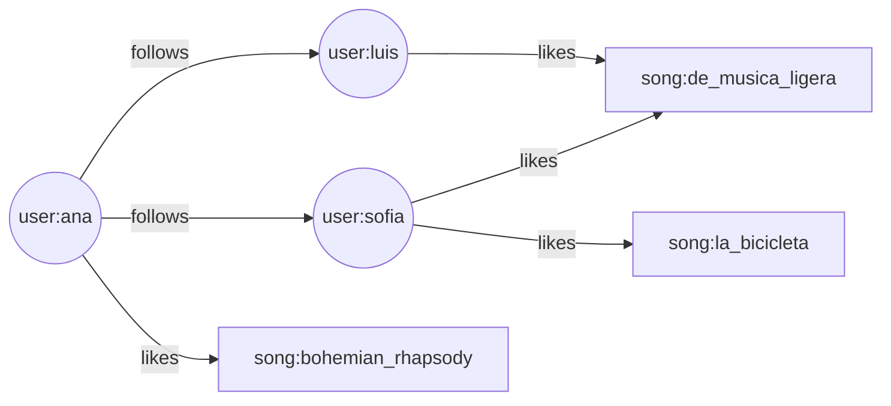

# surreal-music-graph

API REST de ejemplo construida con **Node.js + Express + SurrealDB** para la exposición sobre bases de datos multimodelo.

El proyecto modela una red social musical pequeña y usa tres capacidades de SurrealDB en una misma base de datos y con un solo lenguaje (SurrealQL):

| Modelo | Dónde se usa |
| --- | --- |
| **Documentos** | `user` y `song` guardan objetos JSON; `song.metadata` es un objeto flexible (cada canción puede tener campos distintos). |
| **Grafo** | `likes` (user → song) y `follows` (user → user) son aristas creadas con `RELATE`. Las recomendaciones se calculan recorriendo el grafo. |
| **Tiempo real** | `npm run watch:likes` se suscribe con `LIVE SELECT` y muestra cada like nuevo al instante. |

## Modelo de datos



Consulta de recomendaciones (canciones que les gustan a las personas que sigo y que yo todavía no tengo):

```sql
SELECT out AS song, count() AS score, array::distinct(in.username) AS likedBy
FROM likes
WHERE in INSIDE $user->follows->user
  AND out NOTINSIDE $user->likes->song
GROUP BY song
ORDER BY score DESC
LIMIT 5
FETCH song;
```

## Requisitos

- Node.js 20 o superior
- SurrealDB 4.x

Instalación de SurrealDB:

| Sistema | Comando |
| --- | --- |
| Windows (PowerShell) | `iwr https://windows.surrealdb.com -useb \| iex` |
| macOS | `brew install surrealdb/tap/surreal` |
| Linux | `curl -sSf https://install.surrealdb.com \| sh` |
| Docker | `docker run --rm -p 8000:8000 surrealdb/surrealdb:latest start --user root --pass root memory` |

## Cómo ejecutarlo

1. Iniciar SurrealDB (en memoria, para pruebas):

   ```bash
   surreal db start --user root --pass root memory
   ```

   Para que los datos persistan en disco: `surreal db start --user root --pass root surrealkv:data/music.db`

2. En otra terminal, instalar dependencias y configurar el entorno:

   ```bash
   npm install
   copy .env.example .env
   ```

3. Crear el esquema y cargar los datos de prueba:

   ```bash
   npm run db:setup
   npm run db:seed
   ```

4. Levantar la API:

   ```bash
   npm start
   ```

5. (Opcional) En otra terminal, ver los likes en tiempo real:

   ```bash
   npm run watch:likes
   ```

## Endpoints

Base: `http://localhost:3000/api`

| Método | Ruta | Descripción |
| --- | --- | --- |
| GET | `/users` | Lista usuarios con número de seguidores y seguidos |
| POST | `/users` | Crea un usuario `{ username, email, favoriteGenres? }` |
| GET | `/users/:userId` | Perfil con seguidores, seguidos y canciones favoritas |
| GET | `/users/:userId/likes` | Canciones que le gustan al usuario |
| POST | `/users/:userId/likes` | Registra un like `{ songId }` |
| DELETE | `/users/:userId/likes/:songId` | Elimina un like |
| POST | `/users/:userId/following` | Sigue a otro usuario `{ userId }` |
| DELETE | `/users/:userId/following/:followedId` | Deja de seguir |
| GET | `/users/:userId/recommendations` | Recomendaciones calculadas con el grafo |
| GET | `/songs?genre=rock` | Canciones ordenadas por número de likes |
| POST | `/songs` | Crea una canción `{ title, artist, genre, duration, metadata? }` |
| GET | `/songs/:songId` | Detalle de la canción y quiénes le dieron like |

En `requests.http` hay ejemplos listos para probar con la extensión REST Client de VS Code.

## Estructura

```
database/
  schema.surql      esquema (tablas, campos, índices, relaciones)
  seed.surql        datos de prueba
src/
  config/           variables de entorno
  database/         conexión al SDK y utilidades de RecordId
  validators/       validación de entradas
  services/         consultas SurrealQL
  controllers/      respuestas HTTP
  routes/           rutas REST
  middlewares/      manejo de errores
  utils/            respuesta HTTP comun
  scripts/          setup, seed y consulta en vivo
```
